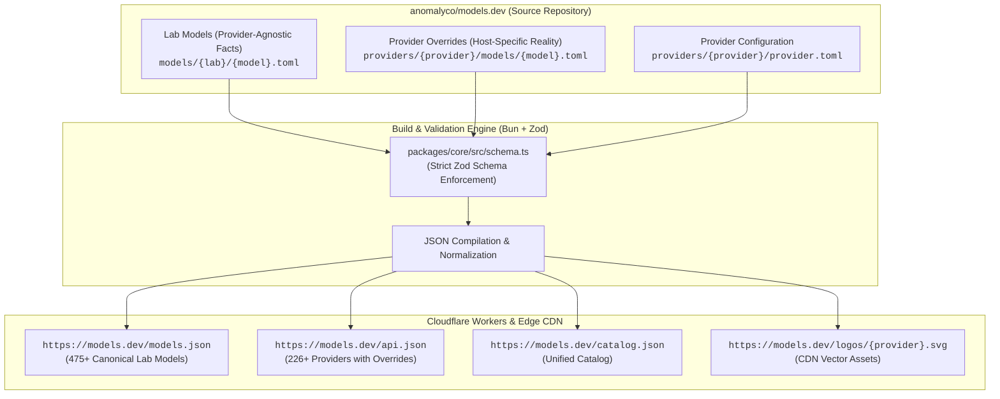
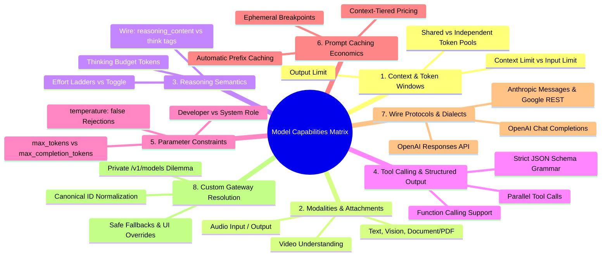
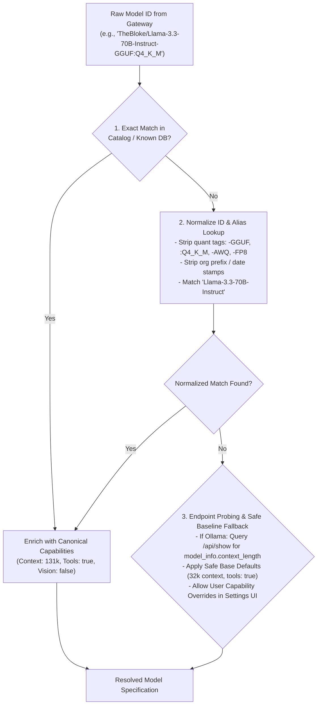
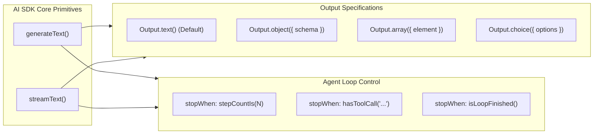
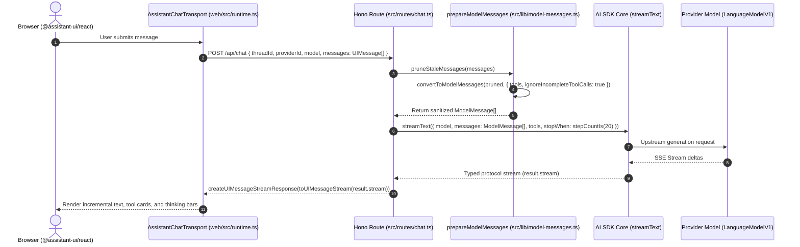

# Model Discovery, Capabilities Taxonomy, and AI SDK Core Architecture Study

> **Document Status:** Authoritative Architectural Study & Design Blueprint  
> **Location:** `docs/model-discovery-and-ai-sdk-architecture-study.md`  
> **Scope:** Architecture, Ecosystem Research, and Capability Taxonomy Only (Zero Source Code Changes)  
> **Date:** October 2026

---

## 1. Executive Summary & Problem Formulation

### 1.1 The Model Discovery Dilemma in Production AI Systems
Modern AI applications can no longer rely on static, hardcoded lists of models and context window sizes. The generative AI ecosystem evolves daily: new foundation models are released, context windows expand from 8k to 1M+ tokens, and inference providers (OpenAI, Anthropic, Google, DeepSeek, Groq, Together, DeepInfra, vLLM, Ollama) serve identical weights with radically different operational parameters, rate limits, pricing tiers, and wire protocols.

Historically, systems treated model configuration as a simple tuple:
```typescript
// Fragile, obsolete abstraction:
type NaiveModel = { id: string; contextWindow: number };
```

In production, this abstraction fails catastrophically:
1. **Parameter Rejections:** Calling `temperature: 0.7` on reasoning models such as OpenAI `o1`, `o3-mini`, or Anthropic `claude-opus-5-5` triggers an immediate **`HTTP 400 Bad Request`** rejection from the upstream provider.
2. **Context vs. Output Pool Asymmetry:** Passing prompt tokens into an Anthropic model operates under an **independent completion pool** (e.g., $1\text{M}$ context, $128\text{k}$ max output), whereas passing tokens to an OpenRouter or custom gateway operates under a **shared total pool** ($\text{input} + \text{output} \le \text{context}$).
3. **Reasoning Stream Dialects:** Open-weight reasoning models (DeepSeek-R1, Qwen-QwQ, GLM) stream their thinking either enclosed in `<think>...</think>` tags in standard text deltas or inside an interleaved `reasoning_content` delta property. Without dialect awareness, thinking content either pollutes user output or is silently discarded.
4. **The Private Gateway Blind Spot:** Private OpenAI-compatible gateways (`vLLM`, `LocalAI`, `LM Studio`, `Ollama`, `LiteLLM Proxy`) return bare `/v1/models` JSON arrays containing only `{"id": "...", "object": "model"}` with **zero capability metadata**.

### 1.2 Purpose of this Document
This study provides:
1. An exhaustive architectural analysis of **`models.dev`** (its schema, Cloudflare edge compilation, and connection to OpenCode).
2. The **8 Critical Capability Dimensions** required to model any LLM accurately.
3. A comparative breakdown across **AI SDK v7**, **OpenRouter**, **LiteLLM**, **Ollama**, **Cline**, and **OpenCode**.
4. A durable **3-Tier Resolution Strategy** for custom and private gateways.
5. A comprehensive architectural analysis of **AI SDK Core v7** (`ai@7.0.137`), detailing its generation primitives, declarative loops (`stopWhen`), structured data generation (`Output.*`), tool governance (`toolApproval`), middleware, and transport bridge to `@assistant-ui/react`.
6. A forward architectural blueprint for TBAi that respects all non-negotiable quality rules and boundary protections in `AGENTS.md`.

---

## 2. Deep Dive: `models.dev` Architecture & Schema Internals

`models.dev` is an open-source, community-governed AI model database and edge registry created by **Anomaly Innovations (`anomalyco`)**—the engineering team behind SST and **OpenCode**.

### 2.1 Repository Architecture & Build Pipeline



#### The Three Structural Tiers of `models.dev`:
1. **Lab Models (`models/<lab-id>/<model-id>.toml`):**  
   Encapsulates physical, intrinsic properties of the model weights created by the research lab (Anthropic, OpenAI, Google, DeepSeek, Meta, Alibaba, etc.). Contains base parameter sizes, knowledge cutoff dates, base context limits, native modalities, and benchmarks.
2. **Provider Overrides (`providers/<provider-id>/models/<model-id>.toml`):**  
   Encapsulates the specific operational characteristics of a host or relay (DeepInfra, Together, Groq, Fireworks, OpenRouter, AWS Bedrock). Providers reference the core lab model via `base_model` / `canonical_model_id` and supply host-specific pricing, context caps, rate limits, and status flags (`alpha`, `beta`, `deprecated`).
3. **Provider Definitions (`providers/<provider-id>/provider.toml`):**  
   Encapsulates provider-level connection details: display name, AI SDK package name (`npm`, e.g., `@ai-sdk/openai`, `@ai-sdk/deepinfra`), authentication environment variable keys (`env`, e.g., `["DEEPINFRA_API_KEY"]`), documentation URLs, and optional custom base URLs (`api`).

### 2.2 Live Data Schema & Field Semantics

Inspection of live payloads (`https://models.dev/models.json` and `https://models.dev/api.json`) reveals the exact fields compiled by `models.dev`:

```typescript
export interface ModelsDevProviderModel {
  id: string;                          // Provider model string (e.g., 'tencent/Hy3')
  canonical_model_id?: string;         // Pointer to lab definition (e.g., 'tencent/hy3')
  name: string;                        // Human readable display name
  description?: string;                // Model description and summary
  family?: string;                     // Architecture family ('claude-sonnet', 'llama', etc.)
  status?: 'active' | 'alpha' | 'beta' | 'deprecated';
  open_weights: boolean;               // True if weights are publicly downloadable
  release_date?: string;               // ISO date (YYYY-MM-DD)
  last_updated?: string;               // ISO date (YYYY-MM-DD)

  // Token Limits
  limit: {
    context: number;                   // Maximum total context window in tokens
    input?: number;                    // Maximum input tokens allowed (if capped below context)
    output: number;                    // Maximum generation tokens
  };

  // Modalities & Capabilities
  attachment: boolean;                 // Accepts file/media attachments
  modalities: {
    input: Array<'text' | 'image' | 'audio' | 'video' | 'pdf'>;
    output: Array<'text' | 'image' | 'audio' | 'video'>;
  };
  tool_call: boolean;                  // Supports tool/function calling
  structured_output?: boolean;         // Supports strict JSON schema / grammar enforcement
  temperature: boolean;                // False if model rejects temperature parameter (e.g., o1)

  // Reasoning Semantics
  reasoning: boolean;                  // Model possesses native reasoning/thinking capabilities
  reasoning_options?: Array<
    | { type: 'effort'; values: Array<'none' | 'low' | 'medium' | 'high' | 'xhigh' | 'max'> }
    | { type: 'toggle' }
  >;
  interleaved?: {
    field: 'reasoning_content';        // Custom wire delta field for thinking chunks
  };

  // Token Economics & Tiered Pricing
  cost?: {
    input: number;                     // $ per million input tokens
    output: number;                    // $ per million output tokens
    cache_read?: number;               // $ per million prompt cache read tokens
    cache_write?: number;              // $ per million prompt cache write tokens
    tiers?: Array<{                    // Context-length tiered pricing
      input: number;
      output: number;
      cache_read?: number;
      tier: { type: 'context'; size: number };
    }>;
  };
}
```

---

## 3. The 8 Critical Dimensions of Modern AI Model Capabilities

A production-grade model capability system must account for eight distinct dimensions:



### Dimension 1: Context & Token Windows
* **Separation of Input vs. Context vs. Output:**  
  A model with a 262k context window does not necessarily accept a 262k prompt. For example, `tencent/Hy3` defines `limit: { context: 262144, input: 192000, output: 128000 }`. Passing a 200k prompt fails even though it fits within the 262k context.
* **Shared vs. Independent Token Pools:**  
  * *Independent Pool (Anthropic, OpenAI Native):* The generation limit is an independent budget up to `max_output_tokens` (e.g., Anthropic Claude 3.7 Sonnet: 200k context, 64k max output).
  * *Shared Pool (OpenRouter, Gateways, vLLM):* The input tokens plus output tokens cannot exceed the context ceiling ($\text{prompt} + \text{completion} \le \text{context}$). If the prompt consumes $90\%$ of the window, only $10\%$ remains for generation.

### Dimension 2: Modalities & Attachment Matrix
* **Modality Boundaries:** Models must explicitly declare supported inputs and outputs across `text`, `image`, `audio`, `video`, and `pdf`.
* **Native Document/PDF Support:** Anthropic models natively accept base64-encoded PDF application documents and parse pages natively. Sending raw PDF buffers to OpenAI or DeepSeek endpoints results in 400 Bad Request errors.

### Dimension 3: Reasoning & Thinking Semantics
Modern reasoning models diverge across three distinct configuration paradigms:
1. **Effort Ladder (`type: "effort"`):**  
   OpenAI (`o1`, `o3-mini`, `gpt-5`) and DeepSeek V4 accept discrete effort levels (`low`, `medium`, `high`, `xhigh`, `max`). Supplying an unsupported effort string causes an API rejection.
2. **Binary Toggle (`type: "toggle"`):**  
   Models like DeepSeek V3.1, MiMo-V2.6, and GLM-5 allow enabling or disabling reasoning modes completely.
3. **Token Budget (`type: "budget"`):**  
   Anthropic Claude 3.7 Sonnet uses explicit numeric token budgets (`thinking: { type: "enabled", budget_tokens: 1024 }`), where thinking tokens count against the total output reservation.
4. **Wire Format Differences:**  
   * Anthropic streams native `thinking_delta` content blocks with signature verification.
   * DeepSeek and Qwen return thinking in an interleaved `reasoning_content` delta field in OpenAI-compatible JSON responses.
   * Open-source models served via standard gateways output raw `<think>...</think>` tags within the regular text delta stream.

### Dimension 4: Tool Calling & Structured Output
* **Strict JSON Schema Enforcement:**  
  Modern models support constrained decoding (grammar masking at the token logit level). Models with `structured_output: true` guarantee 100% adherence to supplied JSON schemas without runtime parsing errors.
* **Parallel Tool Invocation:**  
  High-capability agentic models emit multiple tool calls in a single turn. Smaller models often hallucinate or fail if parallel tool calling is not explicitly disabled via `parallel_tool_calls: false`.

### Dimension 5: Parameter Constraints & Rejections (`temperature: false`)
* **Temperature Incompatibility:**  
  Reasoning models (`o1`, `o3-mini`, `claude-opus-5-5`, `kimi-k3`) strictly disallow temperature adjustments. Passing `temperature` (even standard values like `0.7` or `0.0`) results in immediate **`HTTP 400 Bad Request`** errors. A robust capability registry must track `temperature: boolean` and strip the parameter before dispatch.
* **Parameter Nomenclature:**  
  OpenAI's o-series deprecates `max_tokens` in favor of `max_completion_tokens`. Passing `max_tokens` to newer endpoints triggers parameter deprecation warnings or errors.

### Dimension 6: Prompt Caching & Token Economics
* **Ephemeral Breakpoints (Anthropic):**  
  Uses explicit `cache_control: { type: "ephemeral" }` markers on messages or tool definitions. Caches have a 5-minute TTL; cache reads cost $10\%$ of standard input tokens, while cache writes cost $125\%$.
* **Automatic Prefix Caching (OpenAI / DeepSeek):**  
  Caches identical prompt prefixes automatically above threshold boundaries (e.g., 1024 tokens) without explicit client headers.
* **Tiered Context Pricing:**  
  Models like Qwen 3.7 Max introduce tiered pricing: prompts under 32k tokens are billed at baseline rates ($2.50 / $7.50), while prompts between 32k and 128k are billed at higher rates ($5.00 / $15.00).

### Dimension 7: Wire Protocols & Dialects
* **OpenAI Chat Completions vs. Responses API:**  
  OpenAI native endpoints are transitioning to the Responses API (`/v1/responses`), supporting web search, file search, and computer use natively. Gateways and local runners remain pinned to Chat Completions (`/v1/chat/completions`).
* **System Prompt Semantics:**  
  OpenAI o-series requires system instructions to be passed under the `developer` role. Anthropic requires system instructions as a top-level string parameter outside the `messages` array.

### Dimension 8: Custom Provider & Gateway Resolution
* **The Missing Metadata Problem:**  
  Local inference servers (vLLM, Ollama, LM Studio) expose `/v1/models` solely as:
  ```json
  {"data": [{"id": "meta-llama/Llama-3.3-70B-Instruct-AWQ", "object": "model"}]}
  ```
  Zero metadata is provided regarding context length, tool support, or temperature constraints. Solving this requires a multi-tier resolution strategy.

---

## 4. Comparative Ecosystem Analysis

| Feature / Capability | `models.dev` | AI SDK v7 (`ai`) | OpenRouter (`/models`) | LiteLLM (`model_prices`) | Ollama (`/api/show`) | Cline (`ModelInfo`) | OpenCode (`opencode.json`) |
| :--- | :---: | :---: | :---: | :---: | :---: | :---: | :---: |
| **Primary Role** | Edge Data Catalog | Execution Runtime | Gateway & Proxy | Proxy & Python Map | Local Model Runner | Coding Extension | Terminal Agent |
| **Dynamic Discovery API** | ✅ Yes (`api.json`) | ❌ No (By design) | ✅ Yes (`/api/v1/models`)| ❌ Bundled JSON | ✅ Yes (`/api/tags`) | 🟡 OpenRouter only | ✅ Via `models.dev` |
| **Separates Lab vs Provider**| ✅ Yes (`canonical_id`) | ❌ No | 🟡 `top_provider` | ❌ Flat keys | ❌ Local only | ❌ Flat keys | ✅ Via `models.dev` |
| **Tracks `temperature: false`**| ✅ Yes (`temperature`) | 🟡 Provider warnings | ❌ No | ❌ No | ❌ No | ✅ User checkbox | ✅ Via `models.dev` |
| **Reasoning Options Matrix** | ✅ Explicit ladders | 🟡 Portable enum | 🟡 Instruct type | ✅ Boolean flag | 🟡 Capabilities tag | ❌ No | ✅ Via `models.dev` |
| **Interleaved Wire Field** | ✅ `reasoning_content` | 🟡 Via middleware | ❌ No | ❌ No | ❌ No | ❌ No | ✅ Via `models.dev` |
| **Context vs Output Limits** | ✅ `{context, input, output}`| 🟡 Runtime passed | ✅ Context + max output | ✅ `max_input`/`output` | 🟡 `context_length` | ✅ `contextWindow`/`maxTokens` | ✅ Via `models.dev` |
| **Multi-Tier Context Pricing**| ✅ `cost.tiers[]` | ❌ No | ❌ No | ❌ No | ❌ No | ❌ No | ❌ No |
| **Custom Gateway Support** | 🟡 Provider overrides | ✅ Any `LanguageModel` | ❌ Hosted only | ✅ 100+ gateways | 🟡 Local GGUF | ✅ Manual UI overrides | ✅ `openai-compatible` |

---

## 5. The Custom Provider & Private Gateway Resolution Architecture

When connecting to private inference engines or local relays (vLLM, Ollama, LM Studio, TGI, SGLang, or private LiteLLM proxies), standard `/v1/models` discovery provides zero operational metadata.

### 5.1 The 3-Tier Resolution Strategy

To handle custom and private endpoints without breaking or guessing blindly, a durable solution follows a 3-tier resolution pipeline:



1. **Tier 1: Exact Canonical Match:**  
   Check the raw ID against the canonical catalog (e.g., `models.dev`). If an exact match exists, inherit verified limits and capability flags.
2. **Tier 2: Normalized Heuristic Match:**  
   Apply regex normalizers to strip:
   * Quantization tags: `-GGUF`, `-AWQ`, `-FP8`, `-Q4_K_M`, `-Q8_0`, `:latest`
   * Snapshot dates: `-20241022`, `-2507`
   * Provider/org prefixes: `openrouter/`, `deepinfra/`, `TheBloke/`  
   Map the cleaned stem (`Llama-3.3-70B-Instruct`) to the canonical lab model definition.
3. **Tier 3: Endpoint Probing & Safe Defaults with UI Overrides:**  
   * For **Ollama**: Query `POST /api/show {"name": "..."}`, inspect `model_info["*.context_length"]`, and read `capabilities: ["completion", "thinking", "vision"]`.
   * For **Unknown Gateways**: Apply safe baseline defaults (32,768 context window, temperature enabled, tools enabled) while providing user-configurable capability overrides in the UI (matching the proven Cline pattern).

---

## 6. Deep Dive: AI SDK Core v7 Architecture & Primitives

AI SDK Core (`ai@7.0.137`) is the official execution engine utilized by TBAi. It standardizes language model interactions across providers while leaving application policy, state, and security to the host.

### 6.1 Generation Primitives: `generateText` vs `streamText`



#### `generateText`: Synchronous / Multi-Turn Batch
Ideal for background tasks, summarization, and unattended agents:
* Returns complete result object: `text`, `content`, `toolCalls`, `toolResults`, `usage`, `finishReason`, `steps`.
* Includes per-step `performance` telemetry: `responseTimeMs`, `toolExecutionMs`, `effectiveTotalTokensPerSecond`.

#### `streamText`: Reactive Real-Time Streaming
Ideal for conversational chat and interactive coding agents:
* **Backpressure-Driven:** Tokens are generated only as pulled by the consumer.
* **Error Shielding:** Mid-stream errors are emitted as stream events (`error` parts) and routed to `onError` without crashing the process.
* **Parallel Streams:** Provides `textStream` (text-only async iterable) and `stream` (typed protocol stream emitting `text-delta`, `reasoning-delta`, `tool-call`, `tool-result`, `finish-step`, etc.).

### 6.2 The Declarative Multi-Step Loop: `stopWhen` Architecture
In AI SDK v7, the deprecated `maxSteps: number` setting is replaced by declarative loop predicates via **`stopWhen`**:

```typescript
import { streamText, isStepCount, hasToolCall, isLoopFinished } from 'ai';

const result = streamText({
  model: 'anthropic/claude-sonnet-5.5',
  messages,
  tools: myTools,
  stopWhen: [
    isStepCount(20),                 // Bound multi-turn execution
    hasToolCall('terminal_command'), // Stop immediately if terminal command executed
  ],
});
```

A single step encompasses:
1. Dispatching messages and active tool schemas to the model.
2. Receiving model output (text or tool call requests).
3. Concurrently executing local tool `execute()` handlers.
4. Appending tool results to the conversation stack.
5. Re-evaluating `stopWhen` predicates; continuing to step $N+1$ if unfulfilled.

### 6.3 Unified Structured Data Generation: `Output.*`
AI SDK v7 completely unifies structured data generation into `generateText` and `streamText`. Standalone `generateObject` and `streamObject` flows are superseded by the `output` configuration:

1. **`Output.object({ schema })`:** Enforces schema validation using Zod or JSON Schema. In streaming mode, `partialOutputStream` emits incremental objects.
2. **`Output.array({ element, minItems, maxItems })`:** Provides `elementStream`, emitting each array element **only after it is 100% complete and validated**.
3. **`Output.choice({ options })`:** Enforces exact enum selection for classification tasks.

### 6.4 Tool System & Human-in-the-Loop Governance (`toolApproval`)
Tools are defined using the `tool()` factory with Zod input validation schemas, descriptions, and optional `strict: true` flags.

#### The `toolApproval` Protocol:
When a tool requires human confirmation (e.g., executing bash commands or deleting files), AI SDK Core v7 provides built-in governance:
* **Modes:**
  * `'not-applicable'`: Tool runs automatically without approval metadata (default).
  * `'user-approval'`: Execution suspends, a `tool-approval-request` event is emitted, and the step cleanly concludes.
  * `'approved'`: Auto-approves while recording an audit event.
  * `'denied'`: Rejects execution and informs the model of policy denial.
* **Continuation Flow:** The client presents an approval card to the user, collects approval, and posts a `tool-approval-response` back into the messages array. On continuation, AI SDK verifies the response and executes the tool.

### 6.5 Model Wrapping & Middleware Architecture
Using `wrapLanguageModel`, developers can intercept and augment model execution transparently:

```typescript
import { wrapLanguageModel, defaultSettingsMiddleware, extractReasoningMiddleware } from 'ai';

export const wrappedModel = wrapLanguageModel({
  model: rawProviderModel,
  middleware: [
    // 1. Enforce default sampling settings or reasoning effort
    defaultSettingsMiddleware({
      settings: { temperature: 0.2 },
    }),
    // 2. Intercept and extract raw <think> tags into structured reasoning events
    extractReasoningMiddleware({
      tagName: 'think',
    }),
  ],
});
```

`extractReasoningMiddleware` is critical for open-weight models (DeepSeek-R1, Qwen-QwQ) served over standard OpenAI endpoints: it strips `<think>` tags from `text-delta` and emits structured `reasoning-delta` events for the UI.

---

## 7. Bridge Architecture: UI Messages to Model Messages

The boundary between `@assistant-ui/react` and AI SDK Core is strictly defined:



### Ingress: `convertToModelMessages`
Transforms client-owned `UIMessage[]` (which contains UI state, approval cards, and form inputs) into clean, LLM-compliant `ModelMessage[]`. The `ignoreIncompleteToolCalls: true` option ensures orphaned tool calls without corresponding results do not corrupt the context stack.

### Egress: `toUIMessageStream` & `createUIMessageStreamResponse`
Transforms the internal protocol stream (`result.stream`) into standard SSE UI events (`text-delta`, `reasoning-delta`, `tool-call`, `tool-result`) formatted with proper headers (`UI_MESSAGE_STREAM_HEADERS`).

---

## 8. Alignment with TBAi Architectural Principles

This study adheres directly to the forward-looking contracts established in `AGENTS.md` and `docs/architectural-principles.md`:

1. **TBAi is the Policy Layer, Libraries do the Heavy Lifting:**  
   TBAi owns workspace resolution, credentials encryption, conversation persistence in SQLite, and tool safety. AI SDK Core owns streaming, tool invocation, and token protocol normalization.
2. **assistant-ui Dependency Train Remains Frozen:**  
   No dependencies were altered. The current architecture wires cleanly into `@assistant-ui/ai-sdk` via `AssistantChatTransport`.
3. **No Monkey-Patching or Fragile Inlining:**  
   Any future model discovery or capability synchronization must live cleanly behind the provider/adapter boundary (`src/config/providers.ts` and `src/services/ai.ts`), consuming verified metadata without polluting the chat route or modifying core runtime state.
4. **Strict Quality Gates:**  
   Zero repository source code was modified, preserving all previously accepted Phase 1 changes and keeping the git working tree clean.

---

## 9. Next Steps & Decision Register Entry

When implementation is scheduled, the recommended sequence is:
1. **Record Architectural Decision:** Add an ADR entry in `docs/decisions.md` documenting the adoption of the 8-dimension capability schema and the 3-tier gateway resolution strategy.
2. **Provider Boundary Integration:** Implement capability enrichment strictly behind `src/config/providers.ts` and `src/services/ai.ts` using verified catalog metadata.
3. **Reasoning Extraction:** Evaluate adding `extractReasoningMiddleware` to gateway models that output `<think>` blocks, ensuring unified thinking display across all models.
