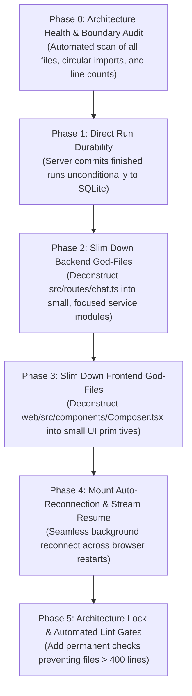

# TBAi Architecture Modernization & Modularization Plan

**Owner / Author:** Principal AI Software Architect  
**Project:** TBAi (AI Chat Application)  
**Date:** 2026-10-10  
**Status:** In Progress (Phase 0 Executing)  

---

## 1. Goal & Architectural Mandate

Bring TBAi into strict compliance with the core engineering standards declared in `AGENTS.md`:
1. **No God-Files**: No single module or component exceeding 500 lines; target 100–300 lines per single-responsibility file.
2. **Clear Dependency Direction**: UI → Store → Service → Data. No circular imports. No reaching across architectural boundaries.
3. **Server-Authoritative Durability**: The backend server is the primary writer of completed message turns into SQLite. Work continues unattended and reconnects smoothly.
4. **Permanent Enforcement**: Establish automated verification gates so future agents cannot introduce architectural drift or code bloat.

---

## 2. Phase-Wise Roadmap

### Phase 0: Architecture Health & Boundary Audit
- Audit all files in `src/` and `web/src/` to identify files exceeding 500 lines.
- Audit layer import directions (check for illegal UI-to-DB or circular imports).
- Verify current test suite baseline (`bun run test`).
- *Gate:* Zero unrecorded architectural violations before modifying code.

### Phase 1: Server-Authoritative Durability
- Remove `!wasDetached` restriction in `src/routes/chat.ts:1539`.
- Verify `finalizeDetachedRunHistory` commits completed assistant messages into SQLite unconditionally and idempotently.
- *Gate:* `bun run typecheck` + unit tests exit 0.

### Phase 2: Slim Down Backend God-Files (`src/routes/chat.ts`)
- Extract single-responsibility service modules out of `src/routes/chat.ts` (currently ~1,975 lines):
  - Request validation & parameter resolution (~150 lines).
  - Context assembly & memory injection (~200 lines).
  - Stream finalization & telemetry (~150 lines).
- Reduce `chat.ts` down to a clean, readable HTTP routing file under 300 lines.
- *Gate:* `bun run typecheck` + `bun run test` exit 0.

### Phase 3: Slim Down Frontend God-Files (`web/src/components/Composer.tsx`)
- Deconstruct `Composer.tsx` (currently ~1,070 lines) into small focused UI primitives:
  - `ComposerInput.tsx` (input box and key handlers).
  - `ComposerActions.tsx` (send/stop buttons, attachments).
  - `ComposerRecoveryAlert.tsx` (stream recovery and alert strips).
- *Gate:* `bun run build` + visual DOM verification.

### Phase 4: Mount Auto-Reconnection & Stream Resume
- Wire `GET /api/chat/stream-status` into conversation mount lifecycle.
- Seed `ResumableClientStorage` to auto-resume active background streams across full browser restarts.
- *Gate:* E2E test verifying browser refresh and restart during an active run.

### Phase 5: Architecture Lock & Automated Lint Gates
- Add automated script `bun run lint:architecture` that fails CI if:
  - Any newly modified file exceeds 400 lines.
  - Any file introduces circular dependencies or illegal cross-layer imports.
- *Gate:* Automated CI passes.

